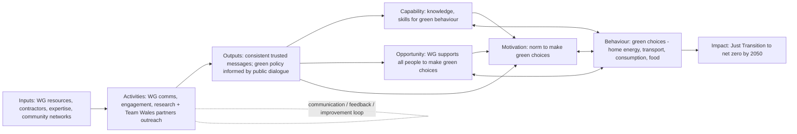

# Theory of Change ground truth pack: Policy Atlas

**Purpose.** This file gives Claude Code reference examples and rules for iterating on Policy Atlas's Theory of Change (ToC) capability. It distils best practice from four published UK theories of change, interpreted against the HM Treasury Magenta Book (May 2026 update) and Nesta's ToC guidance.

**Status of the rules.** Each rule below is either *observed* in the sources or *recommended* for Policy Atlas. Recommendations are marked **PA rule**. Bad practice found in the sources is listed under anti-patterns, not copied.

---

## 0. Summary

1. **Output = diagram + structured text.** The best sources pair the diagram with a narrative of the pathways, a table of assumptions located on links with evidence judgements and justifications, risks and context, and evaluation questions or indicators. Some also offer a text-only version of the diagram (Changing Futures, Child Poverty Strategy). **PA rule:** consolidate this into **five sections**: Summary · How change happens · Assumptions and evidence · What to test and measure · Sources and method (§2.2).
2. **Shape.**
   - Real ToCs have 15–45 boxes, grouped into 3–8 labelled containers.
   - The longest causal chain is 4–8 steps once containers are counted as single units.
   - Layers follow inputs/activities → outputs → short-term outcomes → long-term outcomes → impact, often topped by a single vision statement.
   - Large interventions are split into linked maps (individual / service / system) rather than drawn as one huge diagram.
   - Two views of one ToC work well: a simplified view for communication and a detailed view for analysis.
3. **Assumptions belong on links.** The OEP/EPPS ToC numbers its assumptions (A1–A13) and gives each a location ("Inputs to Activities", "Outcomes to Impacts"). This is the strongest encoding we found.
4. **Evidence judgements need two dimensions.** Sources rate evidence on one scale (EPPS: No evidence / Limited / Some / Good / Strong) or encode it in line styles (Changing Futures: progressing / not enough evidence / not leading). EPPS's "Limited" silently means "evidence *against*", which is exactly the confusion users reported on the canvas. **PA rule:** rate *direction* (supports / mixed / contradicts / none found) separately from *strength* (high / medium / low).
5. **Confidence falls along the chain.** In every source, evidence is strongest near inputs and activities and weakest at impact (e.g. EPPS A13 is rated Limited; Changing Futures links to sustained impact are dashed). A credible Policy Atlas ToC should show this gradient, not uniform confidence.
6. **Show the accountability ceiling and the context.** Changing Futures draws a line marking what the programme can directly influence. The Child Poverty Strategy frames the whole model in "wider context". Both make the ToC more honest about contribution versus attribution.
7. **Ground-truth datasets** for six maps are in `datasets/`, with an overlap-measurement protocol in `02_evaluation_protocol.md`.

---

## 1. The four reference cases

| Case ID | ToC | Level | Built | Best reference for |
|---|---|---|---|---|
| `epps` | OEP / RPA: Environmental Principles Policy Statement duty | Policy implementation (civil service behaviour) | Ex-ante ToC, tested ex-post | Located assumptions, evidence rubric, vision statement |
| `cf_individual`, `cf_service`, `cf_system` | MHCLG: Changing Futures | Programme, three linked levels | ToC updated with evaluation findings (Dec 2025) | Evidence status on links, accountability ceiling, multi-level maps, text version |
| `wales` | Welsh Govt / SYSTRA: Climate Action Wales Public Engagement Strategy | Strategy | Ex-ante (evidence review + 6 workshops) | Simplified + detailed views, ID-coded outcomes, COM-B scaffold, risks per layer |
| `child_poverty` | Cabinet Office / DWP: Child Poverty Strategy | Cross-government strategy | Ex-ante (Evidence Pack + engagement) | Minimal strategy-level shape, wider-context frame, nesting, indicator table |

**Important caveat for evaluation.** The evidence judgements in EPPS and Changing Futures are *ex-post*: they come from evaluating the intervention itself. Policy Atlas produces *ex-ante* judgements from existing literature. Compare *which links are weak*, not exact ratings (see protocol).

---

## 2. Q1: How to structure the accompanying text

### 2.1 What the sources contain

| Section | EPPS | Changing Futures | Wales | Child Poverty | Magenta Book asks for it? |
|---|---|---|---|---|---|
| Purpose / what the ToC is for | ✓ | ✓ | ✓ | ✓ | ✓ |
| Problem, intervention, target group | ✓ | ✓ | ✓ | ✓ | ✓ |
| How the ToC was built (method, who was involved) | ✓ | ✓ | ✓ (evidence review + 6 workshops) | ✓ (Evidence Pack, lived experience) | ✓ |
| How to read the diagram (key) | partial | ✓ (key on map) | — | ✓ (alt text) | — |
| Narrative per layer | — | — | ✓ (impacts → inputs) | partial | — |
| Assumptions with location in chain | ✓ (table) | — | ✓ (in prose per layer) | — | ✓ |
| Evidence strength per assumption or link | ✓ (rubric + justification) | ✓ (line style) | — | — | ✓ |
| Risks / negative programme theory | partial | partial (dotted links) | ✓ | — | ✓ |
| Context and external factors | — | ceiling line | ✓ | ✓ (frame) | ✓ |
| Evaluation questions derived from ToC | ✓ (P1–P5, I1–I4) | ✓ | ✓ (recommendations) | ✓ (Q1–Q10) | ✓ |
| Indicators / measures | — | — | ✓ (suggested) | ✓ (8 indicators) | ✓ |
| Text-only version of diagram | — | ✓ | — | ✓ | (accessibility) |
| Statement that the ToC is "live" and will be revised | — | ✓ | ✓ | ✓ | ✓ |

### 2.2 PA rule: accompanying-text template (five sections)

Target length is **400–800 words** plus two tables. All five sections are required, in this order.

| # | Section | Contents | Length |
|---|---|---|---|
| 1 | **Summary** | Goal; the core logic in one "If… then… because…" sentence; a block of scope fields (population · intervention, or "outcome-first: intervention open" · time horizon · within direct influence up to [layer]); the 2–3 weakest critical links | 100–150 words |
| 2 | **How change happens** | One short paragraph per pathway or layer (e.g. "Engagement → COM-B → Behaviour"), citing node IDs. This section doubles as the text version of the diagram | 150–350 words |
| 3 | **Assumptions and evidence** | One table, critical links by default (5–15 rows): ID · statement · link (from → to) · kind (`assumption` / `risk` / `dependency`) · verdict (BEAM, see `03_beam_evidence_scheme.md`) · why · sources. Then 2–4 sentences on the weakest links: why they might fail, alternative explanations, unintended effects | Table + 50–100 words |
| 4 | **What to test and measure** | 3–6 rows: weak link or assumption · evaluation question · candidate indicator and data source · Test and Learn idea | Table |
| 5 | **Sources and method** | Numbered, auditable reference list (flag non-UK or generic evidence); then 2–3 lines on AI use, search scope and settings, known limitations and human review status (Magenta Book 2026 transparency requirement) | List + 40–60 words |

What moved where (compared with the earlier 10-section draft):
- **Scope** becomes structured fields in the Summary.
- **How to read** leaves the generated text. It's fixed boilerplate, shown in the canvas legend and the export template.
- **Risks** and **context/dependencies** become rows in the Section 3 table (`kind` = `risk` / `dependency`), so a single evidence scheme covers them. The canvas can still show a context band (pattern P7).
- **Evaluation questions** and **indicators** are combined in Section 4, with each row anchored to a weak link.
- **Sources** and **AI disclosure** are combined in Section 5.

Optional add-ons for a fuller write-up (off by default): a methods note, a full context section, and an "all assumptions" table view.

Rules of thumb:
- Write the summary last, but put it first.
- Every claim in Sections 2–4 should reference a node or link ID, so text and canvas stay in sync.
- Keep the Section 3 table to critical links. Long tables bring back the report you are trying to avoid.
- Use Magenta Book vocabulary: inputs/activities, outputs, outcomes (short/medium/long), impact. Don't use "mechanism" as a layer name.
- Say plainly that impacts are *contributed to*, not attributed (Wales and Changing Futures both do this).

### 2.3 Distilled example (condensed from the EPPS source, in the five-section template)

> **1. Summary.** Goal: environmental principles guide ministers and policymakers towards opportunities to prevent environmental damage and enhance the environment. *If* departments receive a clear statement, toolkit, training and cross-government support, *then* they will build processes that make policymakers consider the five principles, *because* a legal duty plus usable tools changes routine policy practice.
> *Population:* ministers and civil servants making policy · *Intervention:* s.19 Environment Act 2021 duty to have due regard to the EPPS (from 1 Nov 2023) · *Horizon:* early operation for implementation; long term for impact · *Within direct influence:* up to outputs (departmental processes and records).
> *Weakest critical links:* whether consideration changes policy content (A12), and whether that yields environmental benefit (A13).
>
> **2. How change happens.** Inputs (I1–I6) equip departments to build their own processes (AC1) and understanding (AC2), which are applied through record-keeping, knowledge sharing and consideration of unintended consequences (AC3–AC5). These produce ministerial policy and departmental records showing the principles were considered (OP1–OP2), which in turn change policy options and framing (OC1–OC4) and attitudes and procedures (OC5–OC8), contributing to environmental protection (IM1–IM3).
>
> **3. Assumptions and evidence (excerpt).**
>
> | ID | Statement | Link | Kind | Verdict | Why |
> |---|---|---|---|---|---|
> | A4 | Toolkit is considered and used as intended | Inputs → Activities | assumption | Confident | All 8 departments used the toolkit as the basis for their processes |
> | A9 | Application of principles is robust, objective, consistent | Activities → Outputs | assumption | Not sure: mixed | Processes applied, but questions over comprehensiveness |
> | R1 | Principles are used to justify preferred options after the fact rather than to shape them | Outputs → Outcomes | risk | Not sure: too little evidence | Seen in at least one impact assessment |
> | A13 | Application results in opportunities for positive environmental outcomes | Outcomes → Impacts | assumption | Not sure: too little evidence | Only general indications; more evidence needed |
>
> No interviewee reported the duty had changed a policy yet, so links beyond outputs rest mainly on stated expectations.
>
> **4. What to test and measure (excerpt).**
>
> | Weak link | Evaluation question | Indicator / data | Test and Learn idea |
> |---|---|---|---|
> | A12 | Has consideration of the principles changed the content of any policy? | Share of EPPS assessments recording a change to options or design (departmental records) | Review a sample of submissions with policy teams |
>
> **5. Sources and method.** [1] RPA for OEP (2024) … Generated with AI assistance from [search scope]; scores reviewed by [name/status].

---

## 3. Q2: Typical structure

### 3.1 Observed shapes (computed from the datasets)

| Case | Boxes | Containers | Links drawn | Of which container-level | Assumptions / risks | Longest chain* | Boxes by layer |
|---|---|---|---|---|---|---|---|
| epps | 26 | 4 | 27 | 9 | 13 | 8 | input 6 · activity 5 · output 2 · short 5 · long 4 · impact 3 · vision 1 |
| cf_individual | 31 | 5 | 14 | 8 | — | 8 | activity 7 · short 9 · long 7 · impact 8 |
| cf_service | 21 | 3 | 16 | 6 | — | 5 | context 1 · activity 9 · short 5 · long 2 · impact 4 |
| cf_system | 32 | 4 | 28 | 11 | — | 8 | context 1 · activity 15 · short 5 · long 5 · impact 6 |
| wales (detailed) | 43 | 8 | 29 | 28 | 10 | 8 | input 4 · activity 5 · output 3 · short 19 · long 1† · impact 11 |
| child_poverty | 15 | 3 | 5 | 5 | — | 4 | context 1 · input 1 · driver 7 · long 4 · impact 2 |

\* Longest chain counts a container as one unit and ignores sideways two-way links.
† Wales behaviour outcomes B1–B3 are held as a single placeholder pending transcription.

### 3.2 Observations

- **Containers carry the logic.** About half of all links run to or from a container rather than a single box. Authors group 2–6 related outcomes and draw one arrow, which keeps diagrams readable.
- **A short, wide chain.** Typically 5–8 steps from input to impact, with 3–7 boxes per layer and 1–3 impacts. The only exception is Wales, which has 11 impacts because it lists wider co-benefits.
- **Sideways links are common** (EPPS activities ↔ activities, Changing Futures service ↔ capacity, Wales Welsh Government ↔ partners). They stand for mutual reinforcement or feedback, not causal steps.
- **Simplified views are tiny.** Wales Figure 3.1 has 5 columns and about 12 blocks. The Child Poverty diagram has 15 boxes and no box-to-box arrows at all.
- **Multi-level ToCs reuse shared nodes.** Changing Futures repeats the same impact boxes ("Services across the system provide flexible… support", "Services… have sufficient capacity") across all three maps. This is how the levels connect.
- **Behavioural scaffolds.** Wales organises its outcomes by COM-B: engagement outcomes → capability, opportunity and motivation outcomes → behaviour → impact. This gives the outcomes layer a tested internal structure.

### 3.3 PA rules: structure

| Rule | Default | Allowed range |
|---|---|---|
| Layers | inputs/activities · outputs · short-term outcomes · long-term outcomes · impact · (optional) vision | Merge inputs and activities (Magenta Book Figure 2.2); add a "drivers" layer for strategy-level ToCs |
| Boxes per layer | 3–6 | 1–8; beyond 8, group into containers |
| Total boxes, detailed view | 15–30 | Up to ~45, or split into levels |
| Total boxes, simplified view | 8–14 | Show containers only |
| Impacts | 1–2 headline impacts | Co-benefits listed in text, not as boxes |
| Longest chain | 5–7 steps | 4–9 |
| Containers | Use when 3 or more boxes share the same incoming or outgoing link | — |
| Sideways links | Allowed only with a stated reason ("reinforces", "feeds back") | Exclude from chain-depth checks |
| Splitting | Split into linked maps (e.g. individual / service / system) when one map would exceed ~45 boxes or mixes levels of actor | Shared boxes keep the same ID across maps |
| IDs | Prefix by layer or theme (A1, E1, M1, OC3) | Stable across versions |

### 3.4 Distilled example: simplified skeleton (Wales Figure 3.1)



---

## 4. Q3: Approaches to judging assumptions and evidence

### 4.1 Observed approaches

| Approach | Source | How it works | Strength | Weakness |
|---|---|---|---|---|
| **Process tracing with a 5-level rubric** | EPPS (Table 2-3) | Each assumption is tested on whether evidence "hints at, suggests, supports or proves" it. Levels: **No evidence** (nothing gathered) · **Limited** (evidence *against*, with no action suggesting it holds) · **Some** (action identified, not how it's implemented) · **Good** (action and implementation identified) · **Strong** (action taken that confirms) | Explicit definitions; justification and report section for each rating | Mixes direction ("against") with strength on one scale |
| **Evidence status on each link** | Changing Futures | Three states: progressing (solid) · not enough evidence to gauge (dashed) · evidence suggests *not* leading (dotted) | Very legible; separates "no evidence" from "negative evidence" | No strength grading; judges progress of this programme, not the wider literature |
| **Qualitative dependencies, assumptions and risks** | Wales | Identified per layer through evidence review and workshops; no ratings | Captures stakeholder disagreement and risks (e.g. food messaging; opportunity gap) | Not tied to specific links; no strength |
| **Evidence base held separately + indicators** | Child Poverty | Separate Evidence Pack; 8 indicators linked to headline metrics | Measurable | Nothing on the diagram itself |
| **Magenta Book requirements** | HMT 2026 | Expose assumptions and the strength of their evidence; consider negative programme theory, alternative explanations and context; stress-test with stakeholders; rigour comes from coherence, specific evidence, triangulation, ruling out alternatives, peer review | Authoritative | No prescribed scale |

### 4.2 PA rule: evidence assessment for each link or assumption

Rate every **link** (and every assumption attached to it) on:

1. **Direction:** `supports` · `mixed` · `contradicts` · `none_found`
2. **Strength:** `high` · `medium` · `low`, judged from:
   - the design and quality of the studies;
   - how many independent sources there are;
   - how consistent they are;
   - how relevant the context is (UK, similar population and setting).
3. **Evidence type**, tagged per source: `evaluation_of_similar_intervention` · `systematic_review` · `primary_research` · `official_statistics` · `expert_or_stakeholder` · `theory_or_logic_only`
4. **Context fit:** `uk` · `comparable_international` · `generic`. This addresses the user finding that evidence skews UK-based or generic.

Display mapping for the canvas, which stays compatible with the EPPS and Changing Futures conventions:

| Direction | Strength | Display label | Line style |
|---|---|---|---|
| supports | high | Strong | solid, thick |
| supports | medium | Good | solid |
| supports / mixed | low | Some | solid, thin |
| mixed | medium/high | Mixed | solid, two-tone |
| none_found | — | No evidence found | dashed |
| contradicts | any | Evidence against | dotted, warning colour |

Rules:
- Never show "weak" without saying *why*: no evidence found, or evidence against.
- State the search scope behind any "none found". Absence of evidence in a limited search is not evidence of absence.
- Expect and allow a confidence gradient: high near inputs, lower towards impact.
- Every rating carries a one-line justification and source IDs (as EPPS does).
- Mark ratings as `ex_ante_literature`. Ex-post evaluation findings, where a user uploads them, are a separate source type.

### 4.3 Distilled examples

```yaml
- link: G_INF -> IM1..IM3        # EPPS, Outcomes -> Impacts
  assumption: A13 Application of principles results in opportunities for positive environmental outcomes
  source_rating: Limited          # EPPS scale
  pa_direction: none_found        # source: "more evidence is needed"
  pa_strength: low
  justification: Only general discussion of changes; no observed environmental outcomes yet
- link: SVC_CAP -> SENG          # Changing Futures individual map
  source_status: not_leading      # dotted line
  pa_direction: contradicts
  pa_strength: medium
  justification: Evaluation evidence suggests service capacity is not yet enabling sustained engagement
- link: Outputs -> Opportunity outcomes   # Wales
  risk: W-R2 Messages not supported by policy making green choices affordable and convenient
  pa_direction: mixed
  pa_strength: low
  justification: Workshop participants judged Opportunity insufficiently addressed by the Strategy
```

---

## 5. Q4: How assumptions and evidence are presented

### 5.1 On the diagram

| Technique | Source | Encode in PA as |
|---|---|---|
| Numbered assumption bars placed *on* the arrows between layers | EPPS (grey A1–A13 boxes) | Edge badge `A#` at the link midpoint; hover shows text, rating and sources |
| Line style = evidence status, with a legend | Changing Futures | Edge style from the table in §4.2; legend always visible |
| Accountability ceiling (vertical dotted line, explained in the key) | Changing Futures | Optional dashed divider between "within direct influence" and "contributes to" layers, user-movable |
| Wider-context frame with arrows into layers | Child Poverty | Context band across the top; context factors as chips; arrows into the layers they affect |
| Colour key for layers | All | Fixed palette, always shown with the key |
| ID codes inside boxes (E1, M1, C1, A1) | Wales, EPPS | Show the ID in the box corner; IDs are stable and referenced in the text |
| Containers with headline labels | All | Container box with a "so what" headline (e.g. "Stabilisation reduces need for intensive caseworker support") |
| Feedback loop drawn as an annotated arc | Wales Fig 3.1 | Curved two-way edge with a label |
| Vision statement as the final box | EPPS | Optional `vision` node above impacts |

### 5.2 In the text

| Technique | Source | Encode in PA as |
|---|---|---|
| Assumption table with a **location** column (e.g. "Inputs to Activities") | EPPS Table 2-1 | Section 3 table columns: ID · statement · link (from → to) · kind · verdict · why · sources |
| Rating table with **justification** and a cross-reference | EPPS Tables 1, 3-1, 4-1 | One-line justification per rating, linked to the sources list |
| Dependencies, assumptions and risks written per layer | Wales | Rows in the Section 3 table with `kind` = `risk` / `dependency`, citing link IDs |
| Text version of the map (one row or bullet per box, grouped by level) | Changing Futures, Child Poverty alt text | Auto-generated "text view" export from the graph |
| Indicator table linked to outcomes | Child Poverty Table 1 | Section 4 table: weak link · evaluation question · indicator and data source · Test and Learn idea |

### 5.3 Distilled example: one assumption, three renderings

```text
Canvas edge:   [G_ACT] ──(A9 ◑ Some)──▶ [G_OUT]
Tooltip:       A9 · Activities → Outputs · Mixed / medium
               "Application and interpretation of principles are robust, objective and consistent"
               Why: processes applied but comprehensiveness questioned · Sources [3][7]
Text table:    | A9 | Application robust, objective, consistent | Activities → Outputs | mixed | medium | … | [3][7] |
```

---

## 6. Pattern library (best aspects of the diagrams, encoded)

Each card has the same fields: Source · What · Why it works · PA implementation spec.

**P1: Located assumptions**
- *Source:* EPPS Fig A3-1, Table 2-1.
- *What:* 13 numbered assumptions sit on the arrows, each with a location.
- *Why it works:* Follows the Nesta rule that assumptions sit on links rather than floating on the diagram; makes testing tractable.
- *PA spec:* `assumption.location = {from: nodeId|groupId, to: nodeId|groupId}`; at least one assumption on every link that crosses the accountability ceiling.

**P2: Evidence-status line styles**
- *Source:* Changing Futures key.
- *What:* Solid, dashed and dotted arrows mean progressing, not enough evidence, and not leading.
- *Why it works:* Users can read evidence quality at a glance, and "no evidence" is distinguished from "negative evidence".
- *PA spec:* Use the §4.2 display table; legend always visible.

**P3: Accountability ceiling**
- *Source:* Changing Futures.
- *What:* A dotted divider marks the limit of direct influence.
- *Why it works:* Supports contribution claims and keeps assumptions focused above the line.
- *PA spec:* `ceiling_after_layer` field, default `output`; rendered as a divider.

**P4: Two views of one ToC**
- *Source:* Wales Figs 3.1 and 3.2.
- *What:* A simplified view with about 12 blocks and arrows, and a detailed view with about 40 coded items.
- *Why it works:* Serves both communication and analysis; users can share the simple view.
- *PA spec:* A view toggle; simplified view = containers only plus headline impact.

**P5: Coded outcome IDs**
- *Source:* Wales (E1–E10, M1–M4, O1–O2, C1–C3); EPPS (A1–A13).
- *What:* Short codes on items.
- *Why it works:* Text, tables and evaluation questions can reference items precisely.
- *PA spec:* Stable IDs; prefix by layer or theme.

**P6: Theory-based outcome scaffold**
- *Source:* Wales COM-B.
- *What:* Outcomes are organised by a behavioural model.
- *Why it works:* Exposes gaps; workshops found Opportunity under-addressed.
- *PA spec:* Optional scaffold (COM-B; realist context–mechanism–outcome) that sets up outcome containers and a gap check, e.g. "no Opportunity outcomes found".

**P7: Wider-context frame**
- *Source:* Child Poverty.
- *What:* The model sits inside a "Wider context" frame with arrows into Drivers and Outcomes.
- *Why it works:* Context is always visible; it doesn't get dropped.
- *PA spec:* Context band plus chips; context factors are evidence-searchable.

**P8: Headlined containers**
- *Source:* Changing Futures.
- *What:* Containers carry a causal headline, e.g. "Stabilisation of health and wellbeing reduces need for intensive caseworker support".
- *Why it works:* The container reads as a claim, not just a category.
- *PA spec:* Container label = a short causal claim.

**P9: Linked multi-level maps**
- *Source:* Changing Futures (individual, service, system).
- *What:* Separate maps share impact boxes and cross-reference each other ("see Service level theory").
- *Why it works:* Handles complexity without one unreadable map.
- *PA spec:* `level` attribute on maps; shared nodes keep the same ID; cross-map link chips.

**P10: Vision anchor**
- *Source:* EPPS.
- *What:* A final box quotes the policy's stated purpose (with its statutory reference).
- *Why it works:* Ties the ToC to the official objective; useful for Green Book strategic fit.
- *PA spec:* Optional `vision` node; filled from the brief.

**P11: Text version**
- *Source:* Changing Futures; Child Poverty alt text.
- *What:* A complete text rendering of the map.
- *Why it works:* Accessibility; readable export; makes diffs between versions possible.
- *PA spec:* Auto-generate from the graph; include it in exports.

**P12: Indicators linked to outcomes**
- *Source:* Child Poverty Table 1.
- *What:* Indicators marked against the outcomes and headline metrics they track.
- *Why it works:* Connects the ToC to monitoring (Magenta Book Figure 4.1).
- *PA spec:* Optional `indicators[]` on nodes; Section 4 table of the text.

**P13: Evidence gradient made visible**
- *Source:* EPPS ratings (Strong → Limited going down the chain); Changing Futures (solid on the left, dashed on the right).
- *What:* Confidence declines towards impact.
- *Why it works:* Honest; tells users where to test.
- *PA spec:* Summary metric "weakest links" listed in the Summary section.

## 7. Anti-patterns (seen in sources, do not copy)

- **One scale mixing direction and strength** (EPPS "Limited" = evidence against). *Fix:* use two dimensions.
- **Assumption bars spanning a whole layer boundary** (EPPS A9–A11 stacked across all activity links). This obscures which specific link they qualify. *Fix:* attach assumptions to specific links; use container links only where truly shared.
- **Column-to-column arrows only** (Child Poverty, Wales detailed figure). The reader can't tell which driver leads to which outcome. *Fix:* always store box-level links; show column flow only in the simplified view.
- **Ever-growing impact lists** (Wales: 11 impacts). *Fix:* 1–2 headline impacts; list co-benefits in text.
- **Dense crossing dashed lines** (Changing Futures system map). *Fix:* auto-layout that minimises crossings; containers; split by level.
- **Repeated boxes without stable IDs** (Changing Futures "Government supports areas…" appears twice on the system map). *Fix:* one node and one ID, rendered once per map.
- **Assumptions only in prose** (Wales). *Fix:* every assumption also lives as structured data on a link.
- **Inputs listed as named products with no causal claim** (common). *Fix:* each input or activity must have at least one outgoing link.

## 8. Suggested output schema (aligned with the datasets)

```json
{
  "toc_id": "string", "title": "string", "level": "programme|policy|strategy|individual|service|system",
  "entry_point": "outcome_first|intervention_first|stress_test",
  "vision": "string|null",
  "ceiling_after_layer": "output",
  "groups": [{"id": "G_EARLY", "layer": "outcome_short", "label": "causal headline"}],
  "nodes": [{"id": "E1", "layer": "input|activity|output|driver|outcome_short|outcome_long|impact|vision|context",
             "group": "G_EARLY|null", "label": "string", "indicators": []}],
  "edges": [{"id": "L1", "source": "E1|G_*", "target": "S2|G_*", "bidirectional": false, "relation": "causes|reinforces|feeds_back",
             "assumptions": ["A1"], "evidence": {"direction": "supports|mixed|contradicts|none_found",
             "strength": "high|medium|low", "basis": "ex_ante_literature|ex_post_evaluation|stakeholder",
             "context_fit": "uk|comparable_international|generic", "sources": ["S3"], "justification": "string"}}],
  "assumptions": [{"id": "A1", "text": "string", "location": {"from": "id", "to": "id"}, "kind": "assumption|risk|dependency",
                   "evidence": {"direction": "...", "strength": "...", "sources": [], "justification": "string"}}],
  "context_factors": [{"id": "X1", "label": "string", "affects": ["layer or id"]}],
  "evaluation_questions": [{"id": "Q1", "text": "string", "targets": ["A9", "L4"]}],
  "sources": [{"id": "S1", "citation": "string", "url": "string", "type": "systematic_review|...", "country": "UK|..."}]
}
```

Datasets in `datasets/` use the same `layer`, `group` and `edges` vocabulary, so Policy Atlas output can be compared directly (see `02_evaluation_protocol.md`).
